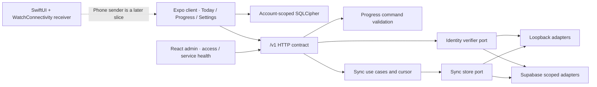

# Initialized Levelmaxing architecture

[Start here](../../START-HERE.md) · [Full architecture](../product/02-production-architecture.md) · [Product design](../product/03-product-design.md) · [Release status](delivery-status.md)

The repository implements the first slice of the full release. The app-facing behavior is an append-only weight log with durable local capture and an account-scoped, versioned export of committed observations. This establishes the sync boundary used later by workouts, meals and other offline commands. Repo setup uses Expo, React, TypeScript, Supabase and SwiftUI because those runtimes meet the platform requirements while keeping one shared mobile client, one cloud write authority and a small operations footprint. [Expo monorepos](https://docs.expo.dev/guides/monorepos/) · [Expo SQLite](https://docs.expo.dev/versions/latest/sdk/sqlite/) · [Supabase Edge Functions](https://supabase.com/docs/guides/functions)

## Dependency direction

- **Backend.** Feature code under `backend/src/features` owns validation, state or authorization for its business boundary. `app.ts` composes HTTP routes through narrow typed dependencies. Local and cloud roots inject identity, persistence and the cursor codec. Node and Edge read hosted settings through one configuration reader with runtime-specific key precedence. The Node HTTP shim translates requests into the Fetch API. Supabase Edge calls the same cloud composition root.
- **Mobile.** File-based routes host feature UI and providers. Session owns the authenticated account and secured auth state. Progress owns the durable confirmed view, queued intents, device enrollment and retry. The account route composes Firebase sign-in, the encrypted store, the ID generator and authenticated transport. Feature adapters own their routes, and Expo SQLite, SecureStore and generic HTTP sit at platform boundaries.
- **Admin.** Access and service health are independent features. The Vite proxy gives localhost the same request path used behind a production same-origin proxy. A backend role and level-two authentication bind access. The operator surface never reads user health values.
- **Watch.** SwiftUI consumes watch-side companion state. Monotonic binding/session rules and deadline logic live in a separately testable package. Phone-side dispatch, rebinding across phones and hardware validation are full-release slices.
- **Shared.** TypeScript apps share wire types, runtime parsers, ordered receipt correlation and product palette roles. Swift uses explicit compact platform payloads. The import harness detects cross-app dependencies, private feature imports, generic platform imports of feature modules, and direct use of shared package sources.

## First write and recovery

1. Authenticate and bind a stable installation to the account. The server returns a generation and dataset epoch.
2. Commit the entered weight as grams with its calendar date and a local outbox operation. The phone can render pending data without waiting for HTTP.
3. Submit the frozen command with the installation ID, generation and monotonically allocated sequence. The server verifies identity from the bearer, validates the command, applies or rejects it, and records the operation result. A retry with identical content returns the receipt.
4. Pull committed groups using an opaque signed cursor bound to the account and epoch. Apply groups in order. The phone commits confirmed data and cursor together and retains unresolved intent for review.
5. A second installation on the same authenticated account begins its own pull. Another account can neither reuse the cursor nor see the observation. Dataset changes invalidate the old context and require repair before replaying uncertain writes.

Protocol uses a progress command version independently of the API major, integer grams, local date and decimal string revisions. Cloud response parsing and caller-scoped RPC are the trust boundaries. The local adapter is process-scoped and has bounded request/response pages. Production authority depends on the database contract below.

## Production PostgreSQL contract

The [SQL drafts](../../backend/database/README.md) remain unapplied. The Node and Edge cloud adapters verify the Firebase token and pass that same scoped JWT into PostgreSQL HTTP RPC. Functions check the provider and use the verified `auth.jwt()` subject to resolve the current Levelmaxing user. The `firebase_uuid` column preserves the exact Firebase UID as text, and the internal UUID remains stable for all existing sync contracts. Each RPC checks scope, bounds, operation, device and account status independently. [Firebase identity design](firebase-identity.md)

| Function | Arguments | Result |
|---|---|---|
| `levelmaxing_resolve_firebase_user_v1` | Empty object | Current internal UUID and database-owned role, derived from the verified token |
| `levelmaxing_register_device_v1` | `p_device_id uuid` | JSON matching device ID, generation and epoch |
| `levelmaxing_push_v1` | `p_request jsonb` | Ordered result per command with stable receipt and applied revision or explicit terminal outcome |
| `levelmaxing_pull_v1` | epoch, after revision, optional high-water, limit | Commit-ordered committed groups with epoch and pinned high-water. Revisions serialize as decimal strings. |

- **Tables and keys.** Account revision and epoch by account. Installations keyed by account/device/generation with a monotonic terminal sequence. Measurements keyed by account/entity UUID with positive bounded grams and a valid date. Receipts keyed by installation/generation/sequence and canonical request digest. Change groups keyed by account/revision. Each retained receipt must match the authenticated actor, operation identity and exact request semantics.
- **Writes.** Lock the account revision row first, then installation and affected domain rows. Commit the measurement, new revision, change item and receipt as one unit. Retain the terminal sequence fence when removing old receipt payloads. Keep account A independent from B. Any future native import or background job that modifies the account must obey the same write order.
- **Reads.** Use indexes on account plus revision, and account plus measured date and ID. Pin the high-water mark for a bounded pull window. Treat expired history as a repair-required condition. Real cloud restore needs an independently managed epoch and consistent snapshots as defined in the full architecture.
- **Grants.** Deny anonymous and direct cross-tenant table access. If definer privileges are needed, pin search paths, schema-qualify all access, deny unnecessary execute grants, derive the caller from verified auth, and review actual RLS/policies. Use private backup and audit controls for health data.
- **Compatibility.** Add new commands and fields using explicit versioning. Preserve the account sequence fence, immutable operation identity and known serialization. Keep canonical pull and new writes on the same authority. A deployment should remain additive until older queued intents and binaries have compatible behavior. Measure load and rollback against matched fixtures in an owner-provisioned environment.

The local adapter reflects state transitions and authorization contract rather than durable database performance. Page assembly is bounded by returned items plus indexed account state in production. Production push targets `O(m log N + k)` for a bounded batch of m commands, indexed rows N and k affected view rows. Production pull targets `O(log N + k)` indexed work with page-bounded auxiliary memory. Any measured latency, locking, restore or capacity result belongs in the delivery ledger.

**Human-owned follow-up, not performed by Codex.** Author and approve the deployment-specific grants and SQL with a database owner. Apply and database-test migrations in an approved environment, run restore/backfill drills, provision Supabase and configure the production proxy and providers. The application layer fails closed through a retryable error on an unavailable RPC, so cloud setup cannot silently discard a queued measurement.

## Runtime and operational setup

The Edge gateway and console ingress policy must be reviewed together. The admin serves under a same-origin host, with a reverse proxy that forwards `/api/*` to the function and supplies the project's publishable API key when required. User requests carry Firebase ID tokens. The application authorizes every protected endpoint and exposes shallow liveness separately. Restrict production CORS to the chosen origin. Keep credentials in function secrets. Capture redacted request results, retry rate, cursor repairs and queue age. Verify cloud bundling, liveness routing, JWT role/MFA enforcement and approved provider configuration before publishing. [Supabase Edge authorization](https://supabase.com/docs/guides/functions/auth-headers)
