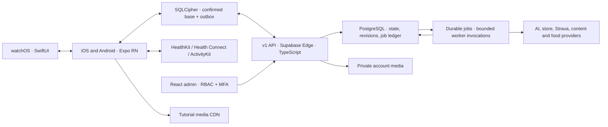
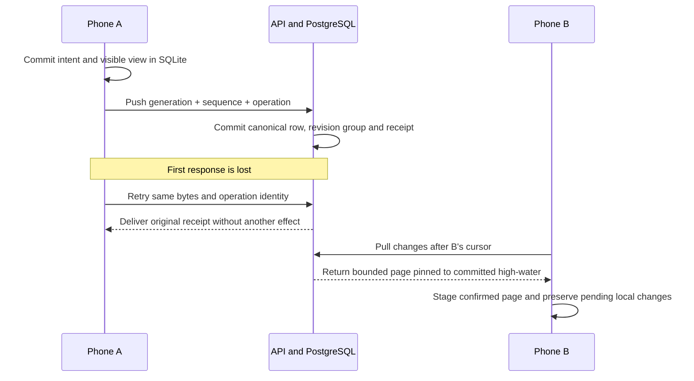

# Levelmaxing production architecture

Design baseline · 23 November 2026 · Proposed until verified in the release environment

[Firebase identity decision and hosted setup](../engineering/firebase-identity.md)

Read alongside the [full-release plan](01-release-plan.md), [product design](03-product-design.md) and [build prompt](04-build-prompt.md). The browser prototype exercises the journeys and server-backed sync separately. This document specifies the native and cloud production system.

## 1. Requirements and operating assumptions

**Confirmed:** The product is Levelmaxing. The brief requests full iOS and Android fitness, nutrition and coaching capabilities from the supplied scope, integrated backend and device sync, and complete design and execution deliverables. The attached research supplies feature breadth. Levelmaxing will use its own interface, exercise content and recommendation rules.

**Proposed:** India-first, adults, English and Hindi, metric defaults with selectable units, single data region at launch, and a paired watchOS companion. Publish an explicit platform/device capability matrix. Treat regional availability, supported age, retention and subscription policy as decisions with release evidence.

Users can finish a workout, record a meal, edit a recipe or log a measurement with intermittent connectivity. The same account converges across supported devices, with an understandable recovery path for overlapping edits. They can review and accept qualified recommendations, connect eligible health services, control sensitive sharing, restore access, export or delete their data. Operators can publish rights-cleared content, see provider failures and costs, and recover service without corrupting historical records.

**Proposed release targets** are engineering budgets for validation.

| Path | Target and measurement context |
|---|---|
| Local logging | p95 ≤100 ms from submit to durable local acknowledgment on a supported mid-range Android phone and oldest supported iPhone, including active-session rehydration after force-close. |
| Sync and search | p95 ≤400 ms server time for a bounded push/pull or catalog query in the launch region. Typical two-client convergence ≤5 s from connected foreground upload to second foreground client with healthy network. Show local, queued, failed and conflict states accurately. |
| Reliability | 99.9% monthly availability objective for valid v1 core online requests, measured by region and route. Diary/session availability offline depends on a usable device and cached data. External providers have separate objectives. |
| Job UX | Job creation p95 ≤500 ms server time. Photo or text scan result p95 ≤20 s with the provider healthy and image already uploaded. Show stage, retryability and cancel control. Investigate queue wait >30 s for 10 minutes. |
| Disaster recovery | Initial proposed RPO ≤24 h, RTO ≤8 h for primary data after a successful drill with daily database and object backups. Evaluate PITR for minutes-level RPO before increasing the launch footprint or tightening the commitment. Device loss before sync can lose local-only edits. |
| Accessibility | WCAG 2.2 AA for web admin and equivalent native checks. VoiceOver/TalkBack, large text, 44 pt iOS and 48 dp Android action areas, high contrast, reduced motion, visible state labels and accessible data equivalents for charts. |
| Data integrity | Zero known tenant leaks, duplicate effects, resurrected deletes, silent loss of pending input or history rewritten by updated catalog/prescriptions. Derive this from failure injection and invariant tests. |

**Unresolved launch dependencies:** App Store and Play accounts, approved health usage and platform entitlements, physical device fleet, Strava access and scope, data-provider rights and India coverage, nutrition and training reviewer, qualified model/privacy terms, operating budgets, original content capacity, and legal review. Clinical diagnosis, fertility prediction, body-composition inference from photos, training injury treatment, and fabricated grocery prices are outside the proposed product.

## 2. System shape and ownership

| Surface | Selection and boundary |
|---|---|
| iOS / Android | React Native, TypeScript, Expo Router and Expo development builds. Use Expo Modules API or vetted native adapters for camera, system OCR, HealthKit/Health Connect. Keep Swift for ActivityKit and Watch Connectivity, Kotlin for Health Connect, SwiftUI for the Watch. Assert SQLCipher at startup in production binaries. Expo Go is useful for limited previews. [Expo native code](https://docs.expo.dev/workflow/customizing/) · [Expo SQLite](https://docs.expo.dev/versions/latest/sdk/sqlite/#sqlcipher) |
| Client data | SQLCipher per signed-in account, unique randomly generated DB key in platform-secure storage and no device backups for sensitive caches. SQLite owns offline writes, optimistic screens, pending operations and cached catalog. Keep refresh credentials in platform-secure storage. Cache accounts independently and enforce a session generation on asynchronous work. |
| Cloud | Firebase Auth for identity, Supabase Postgres, Edge Functions (TypeScript/Deno), private Storage and scheduling. Deploy a public API entry and internal worker entry from a modular monolith. Co-locate database-intensive requests in the primary region. Use one transaction-capable, bounded pooled connection per command group with parameterized SQL and a restricted role. Disable statement preparation where required by pooler mode. Keep Supabase service credentials off mobile/admin builds. [Edge Function limits](https://supabase.com/docs/guides/functions/limits) · [Supabase database connections](https://supabase.com/docs/guides/database/connecting-to-postgres) |
| Search | Bundled versioned common-food and exercise metadata with SQLite FTS, then account custom foods and Postgres indexed search, stable keyset pages. Query normalization and curated synonyms respect language and serving basis. Avoid per-keystroke queries to upstream providers. |
| Media | Private resumable uploads with short grants and verified ingest. Serve licensed tutorial encodes from R2 plus CDN, with caption files and transcripts. Choose public cacheable media only where the rights allow it, otherwise private origin and bounded signed delivery. Tutorials have an editorial workflow with secure upload and external encode or controlled batch publishing. No transcoding in a request handler. [Cloudflare R2 pricing](https://developers.cloudflare.com/r2/pricing/) |
| Admin | React static app with restricted admin API, MFA and server-derived scoped grants. Staff see health content or private records only under reviewed purpose-limited access, with event audit. Use preview and publish as separate actions for content, and audited quarantine for poison jobs. |
| External services | Paid structured AI behind a provider adapter conditional on evaluation, DPA and market eligibility. RevenueCat for App Store/Play transaction lifecycle and reconciliation. HealthKit / Health Connect are device adapters. Samsung uses supported Health Connect interoperability. Strava is an opt-in export connection. |

**Business boundaries:** Identity & consent owns profile, auth lifecycle and device binding. Sync owns sequencing, receipts and change delivery while invoking the domain's command handler. Training owns catalog associations, plans, prescriptions and workout history. Nutrition owns serving conversion, diary, food and recipe versioning. Progress owns measurements, derived read models and cycle observations. Guidance owns rule versions, proposals and verified source references. Media owns asset lifecycle. Integrations own import/export eligibility, dedup and tokens. Billing owns entitlement projection. Editorial owns content and rights. Operations owns support, privacy jobs and availability flags. A module exposes commands, queries and events. One unit of work owns cross-module invariant changes. Events deliver post-commit side effects.

**Physical boundaries:** API, worker and managed services. PostgreSQL gives transactional commits and structured query flexibility with one operational team. Add capacity after measuring saturation. Generate validated transport types for the native app, web admin and API from the same versioned contract. Keep domain decisions on the server and mirror deterministic functions only where local validation or preview needs them. Native capability shims return scoped typed states and attach the active session identity before dispatching native measurements.

## 3. Authoritative data model

Use opaque UUIDs allocated before offline creation. Use PostgreSQL bigint for counters and serialize as decimal strings across runtimes. Use timestamptz UTC and an explicit `local_date` plus IANA zone snapshot for diary/chart attribution. Travel and DST do not reinterpret historical entries. Store exact units and calculation basis, scaled integers or NUMERIC with bounded precision and documented rounding at display edges. Model missing nutrient values as unknown. Resource cardinalities, operation byte budgets and command versions are explicit contract limits.

| Data | Primary records and lifecycle | Key invariants and access |
|---|---|---|
| Accounts and devices | `profile`, `consent_event`, `device_installation`, `watch_binding`, `account_status` | Firebase project and token subject verified at ingress. Map the exact text `firebase_uuid` to the immutable internal account UUID. `(account_id, device_id, generation)` binds terminal sequence progress and capabilities. Consent types version independently. Restricted status gates writes, jobs, collections and evidence. |
| Sync | `account_revision`, `change_group`, `change_item`, `operation_receipt`, `sync_snapshot`, `retired_entity_id` | Revision groups keyed by `(account_id, revision)` and bounded bytes. Applied mutation, affected child deltas, receipt and job intent share one commit. Receipt unique by authenticated device generation and sequence, with operation ID uniqueness within account and contract version/hash. Retired entity IDs retain an identifier fence while that account is live. |
| Training | `exercise`, immutable `exercise_version`, `program`, immutable `program_version`, `prescription`, `program_activation`, `workout_session`, `session_exercise`, `workout_set` | Prescriptions pin exercise/plan revision. Sets and exercises have stable child IDs and order keys. Status and version fence session completion. Owner-scoped foreign keys, `(account_id, performed_at, id)` histories, attributable PR and progression rules. |
| Food and recipes | `food_source`, `food`, `food_version`, `nutrient_value`, `serving`, `barcode_mapping`, `favorite`, `saved_meal`, `recipe`, `recipe_version`, `recipe_ingredient` | Source ID/license/version, edible mass or volume, raw/cooked/unknown, region and attributable alias. Barcode as validated GTIN string including leading zeros. Recipe versions hold yield and refer only to immutable ingredient versions. Active references remain valid for historical ledgers. |
| Diary and targets | `diary_entry`, `diary_item`, `nutrient_snapshot`, `target_version`, `checkin_proposal` | `(account_id, local_date, entry_id)` for diary. Contributions frozen against accepted quantities, snapshots and policy version. Targets and check-in decisions effective-dated and auditable. Concurrent accept tests protect one activation per eligible period. |
| Progress and connections | `measurement`, `photo_asset`, `activity_observation`, `cycle_observation`, `provider_connection`, `provider_record_map`, `external_export` | Units, time and provenance preserved. Import uniqueness scoped to account, provider, origin, type and record identity. Do not equate different vendor IDs. Annotate overlap confidence or use platform aggregate priorities. Cycle observations are explicitly opted in with stricter visibility. |
| Jobs and proposals | `job`, `job_attempt`, `ai_reservation`, `validated_candidate`, `provider_webhook_inbox` | Dedup by feature and source key, payload version, state, scoped lease/fence, deadline and bounded retry. AI has feature/user/global budgets and a unique per-attempt cost ledger. Webhooks unique by provider event and environment. |
| Editorial and commercial | `content_item`, `content_version`, `asset_rights`, `grocery_quote`, `price_provider`, `product_mapping`, `entitlement_projection`, `audit_event` | Require signed review and rights before publish. Price key includes item/pack, locality, currency, provider and observation time. Build entitlements from trusted store mapping, product, account, status and expiration. Administrative actions append redacted actor, target, action, reason and correlation. |

Use composite ownership constraints for nested records plus row-level security as defense in depth. Bind tenant identity in transaction-local database context from the verified auth subject. Use non-owning, non-BYPASSRLS application roles and parameterized identity setup with policies that fail closed on missing context. Workers take an explicitly scoped role or narrowly granted command for internal claims, then use the source account scope for domain changes. Test role/pool reuse across accounts. Foreign keys on historical references favor archive/revoke semantics. Retain superseded media independently of live links according to rights and deletion policy. Use a redacted domain event registry, support staff view of state transitions, and content/user media separation at bucket and grant level. Derived read models carry `source_revision` and rule version. Initial rebuild paths are incremental per day/session plus bounded backfill for a known window. [Supabase RLS](https://supabase.com/docs/guides/database/postgres/row-level-security)

## 4. Stable API and event contracts

API proposed under `/v1`. Commands invoke typed domain handlers. For bounded push, a batch is a transport envelope with ordered independently atomic operations. A multi-row invariant uses one command. JSON responses are explicit schemas. Use a verified token with audience and issuer, subject-derived scoping, registered device context for sync, distinct tokens and grants for admin/worker, and independently verified provider webhook credentials.

| Interface | Main input and output | Authorization / semantics |
|---|---|---|
| `POST /v1/devices`, `GET /v1/capabilities` | Native/runtime build, installation ID, supported schema and API. Response device generation, dataset epoch, supported features/command versions and limits. | Account-scoped registration. Rebinding retires old generations after safe handoff. |
| `POST /v1/sync/push` | `{epoch,deviceId,generation,ops:[{seq,opId,type,version,entityId,expectedVersion,dependsOn?,payload}]}`. Per-op result `applied, conflict, rejected, retry, sequence_gap, processed_receipt_expired` with revision/entity version or problem. | Device auth plus owner derived from token. Up to 50 commands and 256 KiB. Exact repeat returns recorded result during receipt window. Canonical `opId` is derived from `deviceId.generation.seq` and validated, so no new sequence can reuse an expired identity. |
| `GET /v1/sync/pull?cursor=…` | `{epoch,groups:[{revision,items:[{type,id,version,tombstone?,view?}]}],nextCursor,hasMore}`. | Opaque signed account/epoch-bound cursor with pinned high-water and expiry, max 100 groups and defined response-size cap. Wire versions negotiated by capability. |
| `POST /v1/sync/snapshots`, `GET /v1/sync/snapshots/{id}` | Snapshot issue/status; manifest with opaque handle, revision, digest, expiry, chunks and size limits. | Export is purpose-limited device recovery, same owner throughout. Private asset grants minted per account and epoch. |
| Programs, workouts, diary, recipes, targets, progress | Sync commands e.g. `workout.set.add.v1`, `workout.session.finish.v1`, `diary.item.update.v1`, `recipe.version.publish.v1`, `program.activate.v1`, `checkin.accept.v1`. Cursor reads for historical, filtered or uncached data. | Expected version required for edits/deletes, explicit child ownership and dependencies, and immutable historic references. Read endpoints do not advance sync cursor. |
| Catalog, library and grocery | `GET /v1/catalog/foods`, `GET /v1/catalog/barcodes/{gtin}`, `GET /v1/library/items`, `GET /v1/grocery/quotes`. | Rate limits, deterministic keyset sort with ID tiebreak, explicit attribution and staleness. Versioned public catalog packs are independent of personal sync. |
| Media and long-running work | `POST /v1/assets/intents`, `POST /v1/assets/{id}/finalize`, `POST /v1/jobs`, `GET /v1/jobs/{id}`, `POST /v1/jobs/{id}/cancel`. | Bounded resource upload before job dispatch. Idempotency key with canonical body hash for side-effecting REST commands, reused after ambiguous network errors. Acceptance/cancellation first commits authorized state, work remains recoverable. |
| Integrations, billing and privacy | `POST /v1/connections/{provider}/authorize`, `POST /v1/connections/{provider}/disconnect`, isolated callback/webhook routes, `GET /v1/entitlements`, `POST /v1/privacy/exports`, `POST /v1/privacy/deletion-requests`. | PKCE for native OAuth flows where supported. Server exchanges secrets, checks callback state and issuer. Step-up for erasure or sensitive exports; verify protected action scope. |
| Admin | `/v1/admin/content`, `/v1/admin/rights`, `/v1/admin/jobs`, `/v1/admin/budgets` and support views. | Scoped authorization, MFA, redaction and action audit. Publish and replay use internal targeted commands and respect account status. |

Use RFC 9457 errors at the HTTP boundary with stable `code`, trace-linked `instance` and safe field errors. Typical statuses are 400 malformed shape, 401 unauthenticated, 403 no grant, 404 inaccessible or missing resource, 409 version/idempotency/generation conflict, 410 stale cursor, 413 bounded input exceeded, 422 domain validation, 429 throttled with `Retry-After` and 503 retryable. Push uses per-command outcomes for terminal domain conflicts, even when another command succeeds. Never retry 4xx blindly. Paginate against indexed order and scope tokens to owner, filter/query and version. [RFC 9457](https://www.rfc-editor.org/rfc/rfc9457.html)

**Example command:** `diary.item.update.v1` takes an item ID, expected item version, a typed quantity with serving ID, active consent requirements if applicable, and a stable device sequence/operation ID. It returns `applied` with `revision`, `entityVersion` and optional canonical item data. With a stale version it returns `conflict` with the current version, current permitted value or deletion marker, and the reason. The device already holds the draft. A new resolution command requires a new sequence, expected current version and operation ID.

Internal event envelope `{eventId,type,version,aggregateId,aggregateVersion,accountId,revision,causationId,occurredAt,payloadRef}`. Example events are `workout.finished.v1`, `nutrition.diary_changed.v1`, `guidance.proposal_accepted.v1`, `asset.ready.v1`, `billing.reconcile_requested.v1` and `privacy.deletion_requested.v1`. Outbox publishing is at-least-once. Consumers deduplicate by event plus resource version. Provider effects additionally require a provider ID, supported idempotency token, or reconciliation.

## 5. Production synchronization protocol

### Device writes and pending overlay

1. A low-latency SQLite transaction stores the optimistic value and an immutable outbox entry under the current user and generation. Assign `seq` monotonically in that transaction. Use secure storage scoped by account; isolate connections and drop stale callbacks after auth, device or dataset epoch change. A signed-out user's pending data is locked/quarantined for same-account recovery, exported with confirmation, or deleted with explicit intent.
2. Keep canonical confirmed rows separately from optimistic patches and local drafts. Changes from pull never overwrite pending input. Rebuilding a view applies outstanding patches in dependency order over the confirmed base. A conflicting patch is marked for resolution and remains inspectable separately. If a push result supplies a canonical echo, persist it with the acknowledgment without advancing the pull cursor. Otherwise keep that patch as accepted pending canonical pull until the matching revision is visible. Apply versions monotonically so a delayed response cannot rewind newer confirmed state.
3. Serialize uploads per device. Local operations explicitly reference a predecessor when an offline edit depends on an earlier unacknowledged version, or serialize dependent intent construction into the acknowledged version. For frozen transmitted bytes, use a predecessor operation ID that resolves to the exact committed version, validated server-side for the same entity and device. Failed or unprovable prerequisites block dependents. Coalesce only drafts before assigning a sequence. Durably mark an operation as attempted before starting network IO. An abandoned sequence may become an explicit no-op only while its durable state is still never-sent.

### Server commit, idempotency and ordering

1. Authenticate; check account status, epoch, installation generation and capability. For each command begin a short transaction and `SELECT … FOR UPDATE` the account revision row before any account-owned domain mutation. Verify status/generation again under lock. Known receipts return the stored outcome if canonical authenticated envelope plus body hash matches. A changed payload under the same identity fails explicitly. A sequence ahead of the expected next sequence returns `sequence_gap`; a sequence at or below the terminal fence with expired receipt returns `processed_receipt_expired` and never re-executes.
2. Lock and validate narrow domain records, dependencies and resource versions, including entity type and existence. First creation rejects retired IDs. Update/delete uses compare-and-set, frozen validation policy for an already accepted intent, and stable child IDs to allow unrelated changes to commute. Applicable deterministic validation failures and conflicts advance terminal sequence and store the terminal result. Transient/unknown errors roll back without advancement. Authorization or expired context keeps bytes available locally for repair. Lock order for account work is revision → device/conflict state → domain rows → transactional outbox. No provider network request while locks are held.
3. A state-changing command increments the account revision and writes an atomic change group, current versions and required durable job intents in the same transaction as its receipt and terminal sequence fence. Every other account writer, including workers and native imports, participates in that revision discipline. Across accounts, commands proceed independently. Shared catalog and public editorial data have independent version streams. Keep exact receipts for a proposed 30-day rolling window, with durable sequence fences for registered generations or explicit generation retirement. Track a durable acknowledged fence for compaction. A global PostgreSQL sequence cannot establish commit order between concurrent transactions. [PostgreSQL locking](https://www.postgresql.org/docs/current/explicit-locking.html) · [PostgreSQL sequence functions](https://www.postgresql.org/docs/current/functions-sequence.html)
4. Import native data and processed jobs as commands through the same unit of work. Bulk workloads split into independently recoverable bounded units. One logical update can touch many rows within its group-size budget. Large snapshots/catalog data use separate manifests so a single group never needs splitting across pull pages.
5. Foreground wake, reconnect, save and visible catch-up poll trigger push and pull, debounced and backed off with jitter. An optional invalidation message carries no user payload and only prompts pull. Responsive logging and resumability have no dependency on a background execution guarantee. During steady state poll only active eligible views in foreground with idle backoff.

### Conflicts, recovery and removal

- Independent set IDs can append to an open session concurrently. Both devices editing the same set, meal-item quantity, recipe head or program current version get explicit conflict review. A completion command competes with append using group status and appropriate expected session version. If a set arrives after finalization, show retained input and offer an explicit revision/reopen flow. User chooses latest server value, re-applies their draft to the current version with a new operation, or saves as a separate entity where allowed. No implicit client timestamp win.
- Delete produces a tombstone whose ID is retired. An edit against a tombstone yields `deleted_conflict`; recreating the intent is an explicit action with a new ID. Keep minimum tombstone metadata in the retained window, plus an account-scoped retired-ID fence while applicable. Deletion policy trims or excludes sensitive payloads in lookback data as appropriate.
- The first pull fixes one committed high-water mark `H`. Ordered pages contain whole groups in `(cursor, H]`, updating high-water only for the next round. Hold a bounded retention lease during paging; if it expires or a gap is detected, start recovery. The device atomically commits a page with its next cursor and overlays pending drafts. A push receipt acknowledges that op. It never advances pull beyond unrelated changes.
- Bootstrap or old-cursor repair materializes a consistent snapshot at revision `H` from PostgreSQL REPEATABLE READ, whose first read fixes both row state and watermark. Acquire a short-lived retention lease before generation, conservatively protecting the starting revision, then pin it at `H`. Bound snapshot creation by data size and time, use server-owned private chunks, manifest digests and TTL, retain deltas at `H+1` until expiry. Integrity-check and stage to a fresh SQLite base before atomic local swap. Apply subsequent deltas and reconcile preserved outbox operations under the current device/epoch. Keep drafts and accepted receipts distinct.
- If receipt expiry prevents exact replay outcome, pull canonical state and expose unknown historical disposition where needed. Expired generation, rollback epoch or data loss never auto-replays formerly sent payloads. New auth and fresh snapshot let the user reconcile held intents safely against stable entity IDs, versions and reported durability boundary. Never treat “no receipt” as permission to repeat.
- Restore under gated maintenance. Rotate a separate dataset epoch in a control independent of the restored backup, invalidate caches, generations and old worker leases, reapply independent erasure/revocation evidence, then verify snapshots and report retention boundaries to affected users. Reconcile known external side-effect attempts before resuming their dispatch. Previously accepted rows newer than the restore point may require user-assisted recovery. Preserve the original acknowledgment state with an explicit repair status. Account deletion blocks new API requests, blob grants and jobs for that subject. Already issued signed URLs remain bearer grants until expiry or object removal, so use short lifetimes and access-checked delivery where immediate revocation is required.

## 6. Critical flows and failure behavior

| Journey | Normal path | Failure, recovery and proof |
|---|---|---|
| Workout and progression | Select validated plan snapshot, copy prescription into local session, log stable sets and timer deadlines, finish, compute/refresh trends from source revisions. Template generation and substitutions use reviewed equipment, safety and progression rules. | Force-close mid-session restores without inventing reps. Distinct sets converge, conflicting edits remain visible. Timer uses monotonic elapsed time in foreground and recorded expiry across launches. Changing future plans leaves completed histories untouched. Test lb/kg and DST. |
| Food diary, barcode and saved meals | Search local personal items and licensed catalogs; fallback to online catalog query. Barcode decodes checked GTIN and looks up attributable serving data. Confirm serving and log canonical nutrient snapshot. | Unknown barcode → search, label or manual. No network → cached food/manual. Daily totals reflect manual entries and omit unknown nutrient contribution visibly where relevant. Test dry/cooked, edible fraction, density and rounding. |
| Label, photo and text | Label: local Vision/ML Kit OCR then editable serving/table parse, use paid fallback only when enabled. Photo/text: private normalized input, structured component estimate, deterministic catalog mapping, uncertainty and editable quantities. Only explicit confirmation writes ledger nutrients. | Upload expiration, invalid decode, partial labels, no provider, over budget and canceled jobs preserve draft. Late result checks lease and cancellation before publication. Delete source by lifecycle policy. Test weighed representative Indian meals and multi-basis labels. |
| Recipes and sharing | Version ingredients/yield, compute totals and portion fraction, duplicate/substitute into a new version. Controlled URL import extracts structured metadata as a draft, attributable source. Share via revocable scoped link, omit unrelated personal fields. | Unknown yield triggers review, no fabricated conversion or silent application. Constrain URL import to public HTTP(S), reject private/loopback/link-local destinations and unauthorized redirects, enforce DNS checks at egress, content size, media MIME/type limits and parse deadline. Unsupported sites become manual import. Share revoke prevents further access, independent imports remain owned copies per disclosure. |
| Check-ins and coaching | Compute reviewed rule eligibility and accepted data evidence; show missing data, proposal reason, changes, eligible effective date and version. Program job returns validated exercise IDs/equipment/schedule. Coach retrieves only reviewed content and voluntarily supplied allowed context. | Stale proposal cannot activate after relevant edits. Insufficient data yields “needs logs” and no change. Cancellation and feature kill switch keep manual plans/targets usable; new program needs same checks whether manual, rules-generated or AI-proposed. Test unsafe recommendations and missing-data regimes. |
| Progress and cycle | Manual weight, thumbnail photo and adherence from authoritative snapshots, activity with provenance, descriptive signals where data supports trends. Cycle optional, separate consent and manual recording, no clinical inference. | Revocation hides restricted views and stops imports. Missing observations are distinct from measured zero. Dedup overlapping sources or mark uncertainty. Photo permission denied → manual progress. Unavailable means unavailable. |
| HealthKit, Health Connect and Samsung | Permissions in context per data type. Device reads provider anchors/changes or platform aggregate, persists cursor and import intents together, excludes self-export, upserts provider record identity. Proposed directions: steps/activity summaries and weight read if approved; export user-confirmed Levelmaxing workouts by default with a valid write grant. Samsung interop via Health Connect; physical matrix determines supported flows. | Permission revoked/empty/unavailable have distinct fallbacks where platform exposes them. HealthKit read denials may be indistinguishable from absent records. Expired cursor → bounded agreed lookback/reconcile with stable IDs, deletions and source metadata. Do not route raw connected health into AI or analytics. [Apple HealthKit](https://developer.apple.com/design/human-interface-guidelines/healthkit) · [Android sync](https://developer.android.com/health-and-fitness/health-connect/sync-data) · [Samsung interop](https://developer.samsung.com/health/health-connect-faq.html) |
| Watch and Live Activities | Watch caches active workout display context, edits stored locally by binding generation, sends stable message IDs via Watch Connectivity. Phone ACKs only after same-account SQLite persistence, then handles normal sync. ActivityKit displays a user-initiated active workout/rest expiration and recovers/end state on launch. | A→B switch invalidates A's Watch queue binding. Old records lock for same-account recovery; they cannot attach to B. Lost ACK retried without duplicating a set. Lock screen omits sensitive data. Paired physical testing, haptics, heart rate permission, duplicates and stale Activity sessions. [Watch Connectivity](https://developer.apple.com/documentation/watchconnectivity/transferring-data-with-watch-connectivity) · [ActivityKit](https://developer.apple.com/documentation/activitykit/displaying-live-data-with-live-activities) |
| Strava | User connects OAuth, explicitly exports an eligible completed workout via approved create/upload flow. Persist an attempt identity plus provider upload/activity ID. Encrypt tokens beyond standard storage protection, scope to export. | Expired/revoked token prompts reconnect. Respect quota and backoff. Uncertain result stays pending reconciliation before resend. Never reuse Strava data for AI or allow anyone else access via this app's credentials. [Strava API terms](https://www.strava.com/legal/api_policy) · [OAuth](https://developers.strava.com/docs/authentication/) · [Uploads](https://developers.strava.com/docs/uploads/) |
| Grocery and content | Licensed Open Prices or approved local feed supplies observations and freshness. Manual local quote fallback. Editorial publishes original/licensed videos, lessons and localized transcripts through reviewed manifests. | Unknown geography/pack/recency shows unavailable or clearly dated information. Segregate ODbL datasets after rights review. Content availability follows license date and supported locale. Revoke signed access and disallow further CDN publication within policy. [Open Prices data](https://openfoodfacts.github.io/open-prices/guides/data/) |
| Purchases / support / privacy | Buy/restore products through store SDKs plus RevenueCat. Server provisions entitlements only from trusted current provider state. Account export/private download under step-up authorization. Erasure blocks new writes, revokes sessions and removes user data per approved retention and processor policy. | Duplicate/out-of-order webhooks enqueue coalesced reconciliation by app user and environment. Honor verified expiry/grace rules, transfers and refunds without trusting client boolean. Preserve data export and appropriate basic access through billing outage. Deletion rebuild tests check media, device cache and backup non-resurrection. [RevenueCat webhooks](https://www.revenuecat.com/docs/integrations/webhooks) · [Apple review](https://developer.apple.com/app-store/review/guidelines/) · [Google Play account deletion](https://support.google.com/googleplay/android-developer/answer/13327111) |

**Quantities:** nutrition per consumed edible mass = published per-basis amount × mass ÷ source basis. Cooked recipe yield scales portions from the sum of ingredient snapshots. Volume converts to mass only with an appropriate density. Raw and cooked forms remain distinct. Unknown micronutrients propagate coverage information. Put reproducible fixtures at the exact rounding boundary, including manual/calculated calories mismatch. [USDA FoodData Central API](https://fdc.nal.usda.gov/api-guide/) · [USDA Foundation Foods](https://fdc.nal.usda.gov/Foundation_Foods_Documentation/)

**Food data sourcing:** start with USDA-derived attributable basic foods, original region-specific preparations and aliases, user private foods and recipes. Evaluate local food-composition dataset availability/license and the packaged lookup route independently. Keep Open Food Facts records separable with attribution where licensed and avoid merging incompatible terms into a distributable catalog. Prefer indexed cache or permitted bulk dataset over repeated live requests. [Open Food Facts API and terms](https://openfoodfacts.github.io/documentation/docs/Product-Opener/api/)

### Domain policy implementation

- **Program generation and progression.** Begin with reviewed template slots constrained by available days, equipment, user-selected goals and movement preferences. Rank only eligible substitutions by training role and equipment fit, keeping the selected exercise version on the prescription. A proposed progression uses completed eligible sets and a versioned rule. If recent comparable evidence is inadequate, retain the current prescription and explain the gap. A confirmed change applies on a future effective date and records consumed goal/plan versions. Semantics such as warmup exclusion, worked volume, unilateral units and bodyweight load get explicit reviewed definitions and golden fixtures.
- **Check-in freshness.** Compute the evidence window using the diary date policy and record the relevant source versions and rule configuration in the proposal. Recompute current inputs at accept and reject the stale proposal if those inputs changed. An unrelated edit can advance account revision while the proposal remains valid. Save accept/skip history without replacing earlier rationale. Nutrition threshold, change bounds and workout check-in cadence require review and a localized rationale before general release.
- **Progress and cycle insights.** Separate raw observations from self-reported context and computed windows. If there are enough comparable observations, render a descriptive trend with date range, series units and a textual equivalent. Present cycle history from explicit events with optional approximate next-period ranges only after reviewer sign-off and sufficient history. Keep this feature optional and separate from model inputs, export scope defaults and lock-screen text.
- **Grocery and reminders.** Normalize currency in minor units and compute comparable pack prices only when unit conversion is defined. Show provider, observed date, geography and pack basis. Preserve a missing/expired state and editable manual estimate. A reminder stores local time, active timezone policy, consent, purpose, and a stable logical ID. Reconcile scheduled reminders on permission, zone change and sign-out. Avoid sensitive lock-screen copy and duplicate delivery after reconnect.

### Durable job execution and AI isolation

- Persist work intent before returning 202. Trigger one best-effort dispatch for latency and recover with a bounded scheduled sweep. Workers claim jobs with a short transaction and `FOR UPDATE SKIP LOCKED`, writing lease expiry, attempt number and fencing token. Release locks during external work. Re-check lease, feature flag, authorization, deletion and consent before upload/apply. Feature-specific retry budgets, deadlines, jitter, diagnostics and provider concurrency keep problems from queuing on the sync path. Fencing guards database publication. Provider reconciliation guards duplicate external effects.
- State: requested → ready → leased → succeeded/failed/canceled or waiting-retry. Distinguish an attempt with unknown external result from a definitive failure. For paid work reserve ceiling across user/day and global/day before network dispatch; settle actual against the original budget period. If charges are ambiguous, retain reservation and reconcile against usage. A second attempt gets its own reserve. Health privacy or user cancellation disables payload reuse even when provider work already left the system.
- Compress study-quality meal images on-device, normalize file format and remove EXIF/location. Validate byte count, type and actual file characteristics before analysis. Send only opt-in feature inputs with sensitive identifiers removed. Private progress/cycle data, raw connected health information and Strava data stay outside model inputs. Inputs, model output and imported recipe text are untrusted, with strict schemas, calibrated abstention, reviewed recipe/plan safety ranges and no model access to mutation tools. Save reviewable text or plan proposals with source/catalog and model/prompt versions. Include a model kill switch and a reviewed manual route.
- Candidate provider: paid Gemini 3.5 Flash-Lite if intended use, account terms, region, data handling and performance qualify. Google documents adult access restrictions, clinical and medical-advice limits, paid-service DPA handling and limited safety logging. Have privacy/legal owners review retention, subprocessors and possible cross-border processing. Compare alternate qualified model/provider and freeze explicit approved version and endpoint only after benchmark. [Gemini terms](https://aistudio.google.com/docs/terms) · [Model lifecycle](https://aistudio.google.com/docs/deprecations) · [Supabase scheduled invocation](https://supabase.com/docs/guides/functions/schedule-functions) · [PostgreSQL queue locking](https://www.postgresql.org/docs/current/sql-select.html)

## 7. Security, privacy and abuse boundaries

| Boundary | Controls and required evidence |
|---|---|
| Account, native devices and admin | Verify signed auth, expiration, issuer and audience; use per-account cache/key, explicit account switch invalidation, secure links and auth redirect allowlist. Verify every resource ownership and privilege both at command and SQL boundaries. Staff roles, MFA, limited support grants, separate cloud identities and auditable permissions. Test cross-account data access, account switch mid-request, expired auth, client-supplied admin and stale Watch binding. |
| Private blobs and public rights | Upload non-guessable object keys from intent. Scope read/publish access, limit MIME/size, validate and strip metadata. Use secure views and short-lived grants. Prevent shared/progress assets from entering public or CDN unreviewed. Record rights author, media version, locale, expiry and source. |
| Cost and automated abuse | Per-device, per-account, per-route and coarse network limits; job concurrency and budget barriers; reject oversized requests before expensive work; bounded provider fallback, cooldown and spend alerts. Export endpoints protected from broad enumeration. Moderate share/report pathways and rotate exposed credentials through owner process. |
| Sensitive domains | Separate scoped permissions and provenance. User-visible data inventory, explanation before permissions, and analytics only on coarse usage with consent. No credentials, photos, weight, reproductive records, private diary entries, raw body text, model prompts, healthcare source payloads or provider tokens in logs, crashes, URLs or telemetry. Enforce consent before processing and revocation during job execution. |
| Privacy operations | Inventory domain-level retention and exceptions. Proposed defaults subject to review include a seven-day cap for unselected scan sources and a 24-hour cap for generated private exports with shorter access grants. Progress photos persist until user erases them or closes account. Retained backups expire in recovery window and have no live-service access. Disclose store account management, account deletion status and backups. Put access and erasure evidence in separate restricted storage, with retention and audit. Verify applicable laws and notices with owner. [Apple review](https://developer.apple.com/app-store/review/guidelines/) · [India DPDP rules](https://www.meity.gov.in/documents/act-and-policies/digital-personal-data-protection-rules-2025-gDOxUjMtQWa) |
| Delivery and client safety | Sign native builds and approved updates, lock dependencies, inventory SDKs and attest release artifacts. Keep environments, secrets, data and webhook routing distinct. Set CSP and secure admin origins, accessibility with original copy, reduced motion and privacy-friendly notifications. Use ASVS and API risk review as verification guidance. [OWASP ASVS](https://owasp.org/www-project-application-security-verification-standard/) |

## 8. Capacity, operating costs and scaling gates

**Assumed workload:** 20 logging days/month per MAU, 40 mutations per logging day, 12 foreground API requests/day including batched sync, 20 AI meal scans and 20 short coach replies/month per AI-enabled MAU. Plan additional provider/admin pings separately. At 10,000 MAU, 8M operations/month ≈3.1/s averaged across 30 days, ≈31/s at a simple 10× burst. Validate at ≥60 command effects/s with mixed per-account concurrency, reconnects and provider throttling. 2.4M modeled foreground requests/month (~0.93/s average), before background workload. One 1 KiB change entry per operation gives ~7.6 GiB/month at 10k MAU for the delta stream alone. Receipts, indexes, canonical data and backups are extra. Measure live row/JSON/index footprint before reaching 70% of provisioned disk. On compaction reduce full-row deltas, compress large exports, tier retention with recovery and keep immutable source records.

| Scale or pressure | First action | Purpose |
|---|---|---|
| Sustained connection pool/CPU >70% or p95 above target | Inspect query plans, missing indexes, transaction durations and batch size. Right-size compute/pool and cache stable catalog versions. | Keep invariants in the primary transaction. |
| Deep worker backlog | Raise independent worker concurrency within provider quotas, group short operations, enforce retry budgets. Add a separate async runtime only for long/CPU-heavy work that exceeds Edge limits or requires independent scaling. | Sustain scan latency without starving logging. |
| Storage/egress SLO pressure | Bound retained receipt payloads and cursor history, upload small assets, cache tutorial encodes, tier content. Add selective archival/partitioning when evidence justifies it. | Predictable restore time and spend. |
| Read pressure from reports | Validate denormalized rollups, partition analytics workload or add read replica only for bounded-staleness queries. | Push/pull cursors and authorization always use consistent primary state. |
| Global expansion or redundancy mandate | Review regional access, residency, read locality and recovery requirements with evidence, then decide regional pools or warm standby. | Avoid changing per-account write authority without migration and protocol plan. |

**Pricing basis verified 23 November 2026.** Supabase Pro lists $25/month with one Micro compute allocation covered by credit, included 8 GB DB, 7 days of daily backups and 2M Edge invocations/month. Extra environments/compute, PITR, storage, bandwidth and observability are priced separately. R2 Standard lists $0.015/GB-month and metered operations above its allowance with direct internet egress free. RevenueCat lists free use up to $2,500 monthly tracked revenue and 1% tracked revenue at the paid threshold; independently budget store commissions. [Supabase pricing](https://supabase.com/pricing) · [Edge usage](https://supabase.com/docs/guides/platform/manage-your-usage/edge-function-invocations) · [R2 pricing](https://developers.cloudflare.com/r2/pricing/) · [RevenueCat pricing](https://www.revenuecat.com/pricing)

Paid Gemini 3.5 Flash-Lite Standard listed $0.30/M input and $2.50/M output, including thinking tokens. Model baseline: scan 1,500 in/400 out, coach 2,000 in/600 out, 25% retry allowance. Monthly AI spend per AI-enabled MAU = `20 × 1.25 × (3,500 × 0.30 + 1,000 × 2.50) / 1,000,000 = $0.08875`. Benchmark actual image tokenization, job types and cohort behavior. Program generation and paid OCR repair are extra and should have their own rate × tokens budget. [Gemini pricing](https://aistudio.google.com/docs/pricing#gemini-3.5-flash-lite)

| Case | Core plan | Modeled AI | Base subtotal before incremental costs |
|---|---:|---:|---:|
| 100 MAU | $25 | $8.88 | $33.88 |
| 1,000 MAU | $25 | $88.75 | $113.75 |
| 10,000 MAU | $25 pricing floor | $887.50 | $912.50 pricing floor plus ≥$2 modeled Edge quota usage, plus load-tested compute/data capacity |

The model assumes all MAU use the modeled AI quota. At 10,000 MAU, named working estimate floors are directional. Put environment, PITR, operator time, support, transactional email, storage, CDN, retailer feed, device hardware, review and licensing into a separate fully loaded budget. Track cost per successful/canceled/ambiguous scan, configured quota, forecast and high-usage cohort. Gate paid work at reservation and use coarse operational budget warnings at 70/90/100%. Provider invoice still depends on measured usage and contractual terms.

### Complexity and storage notes

| Path | Time / auxiliary space |
|---|---|
| Push | `O(m × log N + k)` for a bounded batch of `m` mutations with indexed lookups and `k` change rows, plus bounded lock/validation work. Process one group at a time, memory proportional to the bounded batch plus largest group. |
| Pull/recovery | Keyset range scan `O(log N + K)` for `K` rows returned, memory bounded by page + active pending overlay. Snapshot `O(S)` work/output for `S` rows in logical scope with streamed chunks and temporary disk/work bounded by retention, one active leased operation per device and windowed history. |
| Day/weekly views | Indexed day/range retrieval `O(log N + K)`; fold over items in `O(K)` time, fixed nutrient vector auxiliary space, compute bounded trend windows `O(D)`. Materialize incrementally only when reads meet measured threshold. |
| Search | Indexed exact barcode `O(log F)`; FTS depends on postings and rank candidates. Bound term length, ranked set, page and results. Cache pack revisions, alias locale and provider license semantics. |
| Recipe and exercise suggestions | Sum or translate `O(I)` ingredients. Prevent nested cycles with bounded DFS `O(V+E)` and visited set if nesting is enabled. Filter exercises by valid constraints then rank a bounded shortlist in `O(E + C log k)`. |

## 9. Observability, release and recovery

**Telemetry:** structured logs key request/trace, route, status, build/runtime, event/command schema and safe error code. Inventory metric definitions for p50/p95/p99, valid-request availability, DB locking/pool pressure, pending mutation age distribution, stale cursor/rebuild rate, conflicts and replay mismatches, job queue wait and aging, uncertain/provider costs, backup freshness, entitlement lag and erasure completion. Telemetry redacts sensitive values by allowlist. Busy path traces sample and retain safe error/latency dimensions, with no unique user IDs in metric labels. Support should diagnose operation state via consented activity reference, pending status and timestamps.

**Suggested alerts:** repeated cross-tenant invariant or idempotency mismatch pages immediately; sync or auth burn-rate alerts use short and long windows to avoid transient false positives; worker/provider outage and budgets notify feature owner while core writes continue. Staff action matrix pairs rollback, kill switch, retry/quarantine and recover a held outbox with named runbook and evidence capture. Escalate delayed owner exports, revocation backlog and restore freshness drift.

**Compatibility and rollout:** Treat protocol major, command schema, storage schema, content pack and native runtime as separate version axes. Initially support current and N−1 released clients and propose a 90-day stable v1 compatibility window, subject to measured adoption. Reader tolerates added optional fields and unknown presentation enum values; unsupported operations return explainable held states. Use additive expanding schemas first, monotonic updates, feature flags tied to supported mutations, versioned views and dual-read/write only when migration warrants. Release current backend only after release candidate + archived client builds can download, replay queued old bytes, and handle conflict by the same semantics. Preserve local outbox through native upgrades and tested mixed-version use. Native contracts change through a new binary, with compatible signed OTA updates only for matching Expo runtime. Launch via internal, closed beta then controlled 5/25/100% release with observation windows for sync, billing and job quality. Disable creation of defective commands before closing a rollout cohort, preserve drain/read ability, roll forward if restoring old code would drop new-shape writes. [Expo runtime versions](https://docs.expo.dev/eas-update/runtime-versions/) · [Expo rollbacks](https://docs.expo.dev/eas-update/rollbacks/)

**Operations:** A maintainer prepares reviewed additive migrations, rollback/forward plan, ordered compatible data transformations, and an old-state fixture. With the user's engineering constraints, schema application, database-backed migration checks, backfills and production deployments are human-owned operations. Validate on a human-prepared isolated schema without running any command or hook that implicitly migrates, synchronizes, resets or cleans a database. Prepare redacted environment manifests and capacity controls. Keep distinct dev/test and prod services, store/AI environments, IAM and backups.

**Recovery:** Practice restore with acquired access but no shared production data in test. Restore Postgres plus separately backed-up private objects, signed CDN artifacts, scheduled job and auth settings, and provider secret inventory. Database backups alone do not include stored objects. Verify account, recipe/history consistency, note orphan/stale media, compare application-level revisions, apply erasure/revocation evidence independent of DB, fence old jobs and generations, re-evaluate consent/provider tokens, then reopen clocked probes. Report RTO and RPO achieved. [Supabase backups](https://supabase.com/docs/guides/platform/backups) · [Restore coverage](https://supabase.com/docs/guides/platform/migrating-within-supabase/dashboard-restore)

## 10. Alternatives and validation gates

| Decision | Tradeoff |
|---|---|
| RN/Expo plus native edges | Shares application flows and contracts while paying explicit Swift/Kotlin/watchOS integration cost. Swift and Kotlin entirely native is viable when two feature teams can sustain parity. Flutter is a credible option when an established team has Flutter expertise. |
| Supabase Postgres modular monolith | One transactional database and managed adjacencies minimize operational assembly. A Workers/D1 approach has a lower nominal entry point and moves more sync/auth/policy design into application code. A managed sync service merits a spike after measuring protocol maintenance or offline window demands. |
| App-owned delta sync and narrow server commands | Explicit histories, validation, recovery and writes from all sources. More implementation than direct table mutations or network-only clients, with tests around ordered commits/compatibility as a release dependency. |
| Inline vs queued AI/provider calls | Interactive local parsing and bounded lookup keep instant tasks quick. Durable jobs absorb uncertain or resumable I/O while adding lease/recovery work. |
| Single region + approved backups | Lower base service cost and one write authority. RTO/RPO and cross-region latency are accepted only after product owner and drill, and a standby proposal is driven by unmet SLAs or market constraints. |

**Evidence required:** prove actual native builds and real backend endpoints against a prepared isolated environment. Use unit fixtures for portion arithmetic, progress and check-in eligibility; contract tests for auth, errors, outbox and typed payloads; HTTP integration for validated and denied requests; connected device tests for the platform matrix; store/provider sandboxes for purchases and retries; and small load plus restore evidence. Test missing response after durable commit, different body reused under one ID, reversed concurrent commits, same-child CAS, delete versus stale edit, expired cursor and receipt, snapshot overlap plus interrupted transfer, account/Watch rebind, old-version upgrade with pending rows, duplicate webhook, billing downgrade and restoration, canceled AI result, budget exhaustion, timezone rollovers, active deletion and restored backup. For scanner accuracy define evaluation sets by food style, lighting, serving ambiguity and readability, with item recall, per-serving error, abstention, correction time, latency and actual cost. Thresholds are provisional until domain reviewer and measured study agree.

**Open release decisions:** device support matrix and operating budgets, localized editorial and food licensing, clinical/wellness and target-change guardrails, AI provider/evaluation policy, launch markets and data residency, local-price provider fitness, provider access, retention, paid features and offline entitlement lease policy, acceptable restored-data window and owner operations. Record approval, dependency and validation in the [release plan](01-release-plan.md), with visual behavior specified in the [product design](03-product-design.md).
